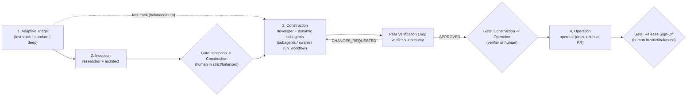

# AI-DLC Agent Skills (`agent-skills`)

An **Antigravity-first plugin** and **portable Agent Skills (`SKILL.md`) suite** implementing the **AI-Driven Development Life Cycle (AI-DLC)** — complete with tunable specialist agents, automatic dynamic subagent spawning, peer-to-peer handoffs, Swarm & `run_workflow` orchestration, adaptive human verification gates, and cross-tool exporters (Claude Code, Cursor, Codex).

## Hybrid AI-DLC Lifecycle



## Quickstart

### 1. Install into Google Antigravity

Install into your global Antigravity plugins directory (`~/.gemini/config/plugins/agent-skills`) or project scope (`.agents/plugins/agent-skills`):

```bash
# User-wide plugin install (copy or symlink)
python3 scripts/install.py antigravity --scope user --method symlink

# Or project-local plugin install
python3 scripts/install.py antigravity --scope project --project /path/to/your/repo
```

### 2. Export to Other Coding Agents (Optional)

```bash
# Claude Code (skills, translated agents, and rules)
python3 scripts/install.py claude-code --scope user

# Cursor (project skills, .mdc rules, and agent guides)
python3 scripts/install.py cursor --project /path/to/your/repo

# Codex (skills and managed AGENTS.md block)
python3 scripts/install.py codex --scope user
```

### 3. Start an AI-DLC Workflow in a Project

Initialize state tracking in a target project (or ask `orchestrator` / `/workflow` in chat):

```bash
python3 scripts/state.py init --project /path/to/project --title "Add OAuth device flow" --intent "Support CLI device login"
python3 scripts/state.py triage --project /path/to/project --depth standard --rationale "Touches auth flow and token storage"
python3 scripts/state.py status --project /path/to/project
```

To execute the scripted pipeline via Antigravity's `run_workflow` tool, pass [workflows/pipeline.py](workflows/pipeline.py) with `{"intent": "...", "depth": "standard"}`.

---

## Specialist Agent Roster (`agents/`)

Every specialist is defined in `agents/<name>.md` and controlled from [config/config.json](config/config.json):

| Agent | Phase | Default Model | Roles | Default Bound Skills |
| :--- | :--- | :--- | :--- | :--- |
| [orchestrator](agents/orchestrator.md) | All | `inherit` | `main` + `sub` | `workflow`, `subagent-orchestration`, `agent-tuning`, `task-decomposition` |
| [researcher](agents/researcher.md) | Inception | `flash` | `sub` (read-only) | `requirements-discovery` |
| [architect](agents/architect.md) | Inception | `pro` | `main` + `sub` | `requirements-discovery`, `architecture-ddd`, `task-decomposition`, `subagent-orchestration` |
| [developer](agents/developer.md) | Construction | `inherit` | `main` + `sub` | `tdd-implementation`, `systematic-debugging`, `refactoring`, `git-pr-workflow`, `subagent-orchestration` |
| [verifier](agents/verifier.md) | Construction | `inherit` | `sub` (read + test) | `code-review`, `systematic-debugging` |
| [security](agents/security.md) | Construction | `pro` | `sub` (read + audit) | `security-audit`, `code-review` |
| [operator](agents/operator.md) | Operation | `inherit` | `main` + `sub` | `release-operations`, `technical-documentation`, `git-pr-workflow`, `incident-postmortem` |

---

## 16-Skill Catalog (`skills/`)

### Orchestration & Meta Skills
| Skill | Purpose |
| :--- | :--- |
| [workflow](skills/workflow/SKILL.md) | End-to-end AI-DLC lifecycle driver (`Triage -> Inception -> Construction -> Operation`) + templates & gate matrix |
| [subagent-orchestration](skills/subagent-orchestration/SKILL.md) | Spawn pre-defined or dynamic subagents (`define_subagent`), pass `SKILL.md` paths, peer `send_message` handoffs, Swarm & `run_workflow` |
| [agent-tuning](skills/agent-tuning/SKILL.md) | Manually tune governance modes, orchestration limits, agent models/tools/skills, and custom instructions |
| [skill-authoring](skills/skill-authoring/SKILL.md) | Author and validate portable Antigravity + `agentskills.io` `SKILL.md` skills |

### Inception Skills
| Skill | Purpose |
| :--- | :--- |
| [requirements-discovery](skills/requirements-discovery/SKILL.md) | Problem framing, clarifying questions, NFRs, non-goals, and Given/When/Then acceptance criteria |
| [architecture-ddd](skills/architecture-ddd/SKILL.md) | Bounded contexts, ubiquitous language, invariants, interface contracts, failure modes, and ADRs |
| [task-decomposition](skills/task-decomposition/SKILL.md) | Split designs into disjoint-file Units of Work verified against collisions via `state.py register-unit` |

### Construction & Verification Skills
| Skill | Purpose |
| :--- | :--- |
| [tdd-implementation](skills/tdd-implementation/SKILL.md) | Strict Red -> Green -> Refactor implementation tied to unit acceptance criteria |
| [systematic-debugging](skills/systematic-debugging/SKILL.md) | Reproduce -> Isolate -> Hypothesize -> Regression Test -> Fix & Verify with 2-attempt anti-thrashing guardrail |
| [refactoring](skills/refactoring/SKILL.md) | Behavior-preserving structural refactoring backed by characterization tests |
| [code-review](skills/code-review/SKILL.md) | Adversarial evidence-based review (`CRITICAL`/`HIGH`/`MEDIUM`/`LOW`) returning `APPROVED` or `CHANGES_REQUESTED` |
| [security-audit](skills/security-audit/SKILL.md) | STRIDE-lite threat modeling and OWASP/supply-chain audit |

### Operation & Collaboration Skills
| Skill | Purpose |
| :--- | :--- |
| [git-pr-workflow](skills/git-pr-workflow/SKILL.md) | Safe branching, conventional commits, secret/diff self-audits, and evidence-backed PR summaries |
| [technical-documentation](skills/technical-documentation/SKILL.md) | Keep READMEs, API docs, architecture diagrams, and runbooks truthful to verified code & commands |
| [release-operations](skills/release-operations/SKILL.md) | Pre-release gate verification, migration/rollback safety, observability checks, and release checklists |
| [incident-postmortem](skills/incident-postmortem/SKILL.md) | Mitigation-first incident triage, timeline reconstruction, blameless analysis, and Inception follow-ups |

---

## Manual Tuning (`scripts/tune.py`)

Adjust gate strictness, subagent caps, models, bound skills, tools, or custom instructions from one CLI — changes sync directly to `agents/*.md` and [rules/gates.md](rules/gates.md):

```bash
# Inspect active governance mode, orchestration caps, and all agents
python3 scripts/tune.py show

# Switch verification gate mode (strict | balanced | autonomous)
python3 scripts/tune.py set-mode strict

# Tune orchestration limits for dynamic subagents
python3 scripts/tune.py set-orchestration --max-depth 2 --max-parallel 3 --default-model flash

# Tune an individual agent (model, skills, instructions, tools)
python3 scripts/tune.py tune-agent developer \
  --model pro \
  --add-skill security-audit \
  --instruction "Always run typechecks alongside unit tests."

# Create a new persistent specialist agent
python3 scripts/tune.py create-agent perf-auditor \
  --description "Profiles latency and memory regressions." \
  --phase construction --model pro --skills code-review,systematic-debugging

# Verify config and markdown files have zero drift, or reset to defaults
python3 scripts/tune.py apply --check
python3 scripts/tune.py reset
```

---

## Dynamic Subagents & Peer-to-Peer Prompting

1. **Pre-Defined & Dynamic Creation**: Agents with `can_spawn_subagents: true` (`orchestrator`, `architect`, `developer`) can both invoke pre-defined specialists (`invoke_subagent`) and create new task-specific subagents automatically (`define_subagent`) — assigning explicit `skills/<name>/SKILL.md` runbooks and least-privilege tool grants within `max_nesting_depth` and `max_parallel_subagents`.
2. **Inter-Agent Handoff Envelope**: Peer prompts via `send_message` follow [handoff-protocol.md](skills/subagent-orchestration/references/handoff-protocol.md) (`READY` -> `NEEDS_REVIEW` -> `CHANGES_REQUESTED` <-> `APPROVED` / `BLOCKED`) and are persistently logged to `.aidlc/handoffs/` via `scripts/state.py record-handoff`.
3. **Parallel Isolation**: Concurrent authors run in `workspace: "share"` with disjoint file ownership enforced at registration time (`state.py register-unit`), while `verifier` and `security` run read/test checks on `inherit`.

---

## Validation & Tests

```bash
python3 scripts/tune.py apply --check
python3 scripts/validate.py
python3 -m unittest discover -s tests -v
```

See [docs/architecture.md](docs/architecture.md) and [docs/customization-guide.md](docs/customization-guide.md) for deeper design and tuning guides.
