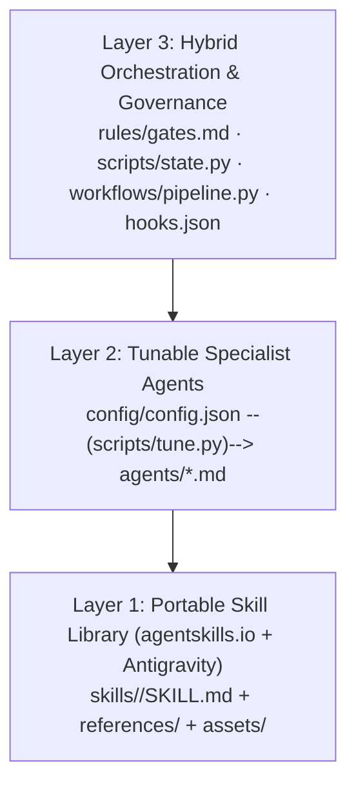

# AI-DLC Architecture Blueprint

This repository separates **portable domain knowledge (`skills/`)**, **tunable specialist personas (`agents/` + `config/`)**, and **hybrid multi-agent orchestration (`scripts/`, `workflows/`, `rules/`, `hooks.json`)** so skills stay reusable across tools while execution remains controllable.

## Three-Layer Design



1. **Layer 1 — Portable Skills (`skills/`)**: Self-contained `SKILL.md` folders placed one level deep under `skills/`. Using progressive disclosure, only `name` and `description` enter startup context; full procedures and `references/`/`assets/` load on demand.
2. **Layer 2 — Tunable Agent Personas (`agents/*.md` + `config/config.json`)**: Each specialist defines native Antigravity tool allowlists, model tier, `mainAgent`/`subagent` visibility, bound `skills/`, and a managed tuning block (`<!-- AIDLC:TUNING:START/END -->`). Hand-written instructions outside the markers are preserved across every `scripts/tune.py apply` sync.
3. **Layer 3 — Hybrid Orchestration & State (`scripts/state.py`, `workflows/`, `rules/`)**:
   - **Direct Delegation (`invoke_subagent`)**: Parent invokes tuned specialists for scoped steps.
   - **Dynamic Subagent Spawning (`define_subagent`)**: Parent or authorized specialist creates bespoke child agents on the fly with explicit `SKILL.md` instructions, bounded by `max_nesting_depth` and `max_subagents`.
   - **Peer-to-Peer Loops (`send_message` / `swarm`)**: Authors and verifiers exchange Handoff Envelopes directly up to `max_review_rounds` before escalating.
   - **Scripted Pipelines (`workflows/pipeline.py`)**: Deterministic `run_workflow` script using `phase`, `agent`, `parallel`, and `pipeline`.

## Adaptive Depth & Governance Gate Matrix

| Dimension | `strict` | `balanced` (Default) | `autonomous` |
| :--- | :--- | :--- | :--- |
| Fast-track skip Inception | No | Yes (<= 2 files, low risk) | Yes |
| `inception -> construction` | `human` | `human` | `auto` |
| `construction -> operation` | `human` | `verifier` (`verifier` or `human`) | `verifier` (`verifier` or `human`) |
| `operation -> completed` | `human` | `human` | `auto` (blocks only on failures) |

## Workspace `.aidlc/` Layout (Per Target Project)

When running AI-DLC on any repository, `scripts/state.py` manages:

```text
<target-project>/.aidlc/
├── state.json                         # Current phase, mode, depth, gate statuses, units, handoff summary
├── inception/
│   ├── intent.md
│   ├── requirements.md
│   ├── design.md
│   └── units.md
├── construction/
│   └── verification-report.md
├── operation/
│   └── release-checklist.md
└── handoffs/
    └── H001-developer-to-verifier.{json,md}
```

File-ownership isolation is enforced when calling `state.py register-unit`: overlapping file paths between two non-approved units fail with a non-zero exit unless `--allow-overlap` is explicitly passed.
