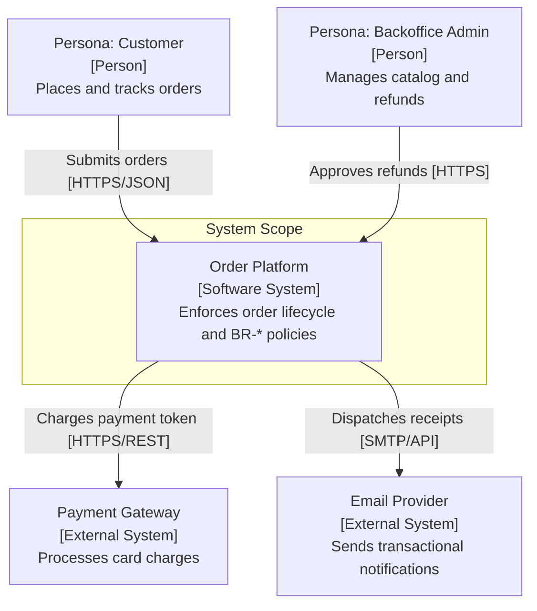
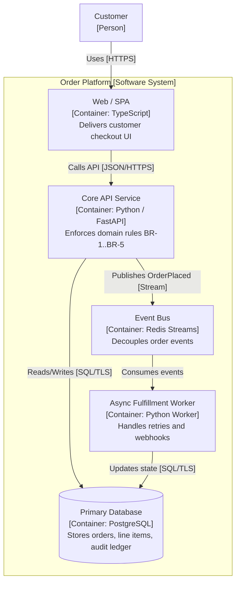
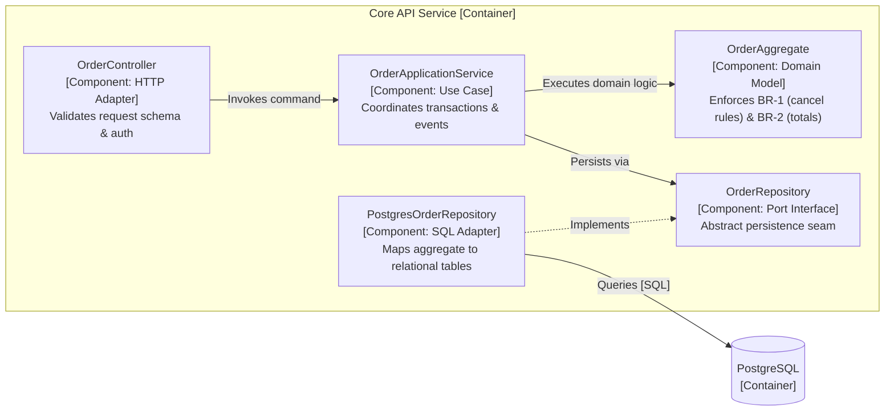
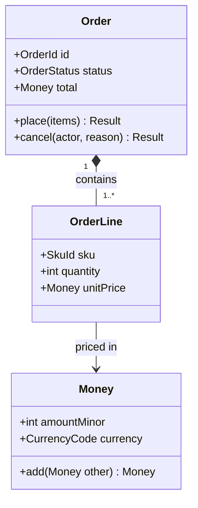

# C4 Model Architecture Diagrams Reference

Use the **C4 Model** (Simon Brown) to visualize software architecture at progressive zoom levels inside `.aidlc/inception/design.md` or `docs/architecture.md`.

By default, render C4 levels using portable **Mermaid `flowchart` and `classDiagram`** blocks (which render natively in Antigravity, GitHub, Cursor, and Obsidian without external plugins). When the user explicitly requests **Structurizr DSL** or **PlantUML C4**, emit that format alongside or instead.

## Which C4 Levels to Generate

| AI-DLC Depth / Scenario | Required C4 Levels |
| :--- | :--- |
| `fast-track` | None (unless explicitly requested) |
| `standard` (feature / module change) | **Level 3 (Component)** — plus **Level 2 (Container)** if crossing service/storage/process boundaries |
| `deep` (greenfield / cross-system / security boundary) | **Level 1 (System Context)** + **Level 2 (Container)** + **Level 3 (Component)** (+ **Level 4 (Code/Domain)** for complex aggregates) |

Every node label MUST state: **Name**, **[Type / Technology]**, and a **1-line responsibility**. Every edge MUST label the **action and protocol/contract**. Quote any label containing parentheses or brackets (`id["Label [Tech]"]`).

---

## Level 1: System Context Diagram (People & External Systems)

Shows the system as a single black box surrounded by user personas and external systems.

---

## Level 2: Container Diagram (Deployable Units & Data Stores)

Zooms into the software system to show runtime containers (apps, APIs, workers, databases, queues).

---

## Level 3: Component Diagram (Internal Modules & Seams)

Zooms into a single container to show deep modules, domain aggregates, ports, and adapters.

---

## Level 4: Code / Domain Class Diagram (Optional — Complex Aggregates)

Use `classDiagram` only when an aggregate or state machine has non-trivial business rules (`BR-*`) and invariants worth showing at type level.

