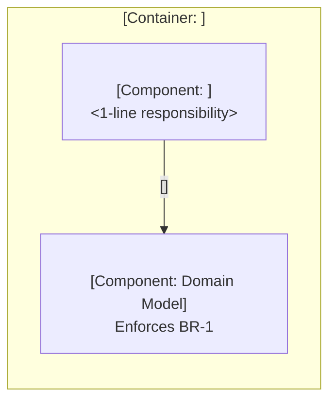

# Technical Design & Domain Model (`.aidlc/inception/design.md`)

## 1. Bounded Context, Ubiquitous Language & Business Rule Mapping

- **Bounded Context**: `<domain area>`
- **Core Terms**:
  - `<Term>`: `<exact definition in code and specs>`
- **Business Rule Enforcement (`BR-*`)**:
  - `BR-1`: Enforced by `<Aggregate / Domain Policy / Module>`

## 2. C4 Architecture Diagrams

> Follow `skills/architecture-ddd/references/c4-diagrams.md` (include L1 Context + L2 Container for `deep` runs; L3 Component for `standard` and `deep`).

## 3. Component & Interface Design

<Describe modules, responsibilities, data flows, and public interfaces.>

## 4. Invariants & Failure Modes

| Invariant / Failure Mode | Guardrail / Mitigation | Verification Strategy |
| :--- | :--- | :--- |
| `<invariant or failure>` | `<how prevented or handled>` | `<unit/integration test>` |

## 5. Architecture Decision Records (ADRs)

- **ADR-001**: `<Decision>` — Chosen over `<Alternative>` because `<trade-off rationale>`.
